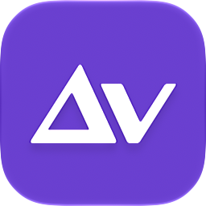
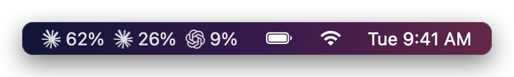
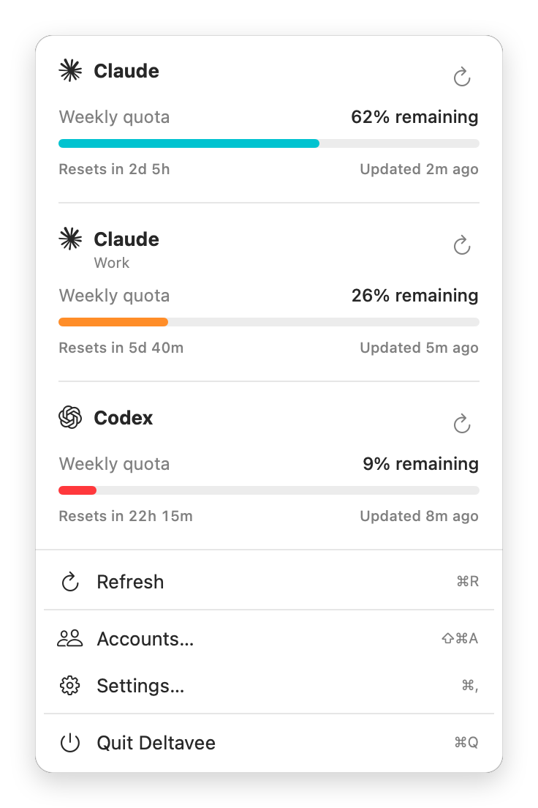

<p align="center">
  
</p>

<h1 align="center">Deltavee</h1>

<p align="center">Claude·Codex 구독 계정별 주간 사용량을 macOS 메뉴바에 표시합니다.</p>

<p align="center">
  
  
  
  
</p>

<p align="center"><a href="README.md">English</a></p>

Deltavee(`/ˈdɛltəviː/`)라는 이름은 우주선이 궤도를 바꾸는 데 쓸 수 있는 속도 변화량 예산인 delta-v(Δv)에서 따왔습니다. 여기서는 agent가 쓸 수 있는 남은 사용량을 뜻합니다.

Deltavee는 같은 제공자의 계정 여러 개를 포함해 Claude·Codex 계정을 함께 표시합니다. 계정마다 Claude Code나 Codex CLI가 이미 유지하는 로그인 상태를 읽으므로 앱 자체 로그인은 없습니다.

<p align="center">
  
  <br>
  
</p>

<p align="center">
  
  
</p>

## 기능

- 메뉴바에 계정별 주간 사용량을 제공자 로고와 함께 표시합니다. 기본은 남은 비율이고, 사용한 비율로 바꿀 수 있습니다. 끝의 `!`는 마지막 조회 실패를 뜻합니다. 1시간 넘게 지난 값은 흐린 색으로 표시하며, `Color menu bar usage`를 켜면 빈 점으로 구분합니다.
- 패널에는 사용한 비율에 따라 색이 바뀌는 주간 사용량 막대와 한도 초기화 시각을 표시합니다.
- 계정마다 레이블을 붙이고, 드래그로 순서를 바꾸고, 메뉴바 표시 여부를 정할 수 있습니다.
- 전체 계정을 주기적으로 조회하거나 계정 하나를 즉시 조회합니다. Claude rate limit에 걸리면 재시도하지 않고 해제 시각까지 기다립니다.
- 토큰을 저장하지 않습니다. Claude의 `Statusline Only` 모드는 Claude 수집의 Keychain·네트워크 접근을 끕니다.
- 설정하면 로그인 시 실행합니다.
- 새 정식 버전이 있으면 패널에 알립니다. 다운로드 페이지를 열어 직접 설치하며, 앱이 자동으로 다운로드하거나 설치하지 않습니다.

## 수집 방식

- Codex: 계정별로 Codex CLI를 실행해 주간 한도를 조회합니다. 앱은 `auth.json`을 읽거나 쓰지 않습니다. OpenAI는 로컬 또는 오픈소스 앱의 app-server 인증을 허용하지만, 상업·호스팅 서비스에는 허용하지 않습니다([Codex app-server](https://learn.chatgpt.com/docs/app-server#auth-endpoints)).
- Claude: CLI의 자격증명으로 비공식 API를 조회하고, 실패하면 statusline 기록을 읽습니다. 앱은 refresh token을 쓰거나 자격증명을 저장하지 않습니다. access token이 만료되면 Claude Code를 실행해 갱신하며, 실행마다 Haiku 모델 요청 1회분의 사용량을 소모합니다.
- 주간 사용량만 수집합니다. 5시간 한도 등 다른 한도는 표시하지 않습니다.
- 앱 데이터는 `~/Library/Application Support/dev.pers0n4.deltavee/`에 저장하며 토큰은 저장하지 않습니다.

갱신 방식·데이터 저장·계정 위험은 [수집 동작](docs/collection.md), 표시 설정·업데이트 알림은 [화면 안내](docs/interface.md)를 참고합니다.

> [!WARNING]
> 기본 Claude 모드는 Claude Code의 Keychain 항목을 읽어 비공식 endpoint를 호출합니다. Anthropic은 개발자가 Claude.ai 자격증명이나 세션 토큰을 수집·저장·중개하는 것을 허용하지 않습니다([Legal and compliance](https://code.claude.com/docs/en/legal-and-compliance)). 이 사용의 허용 여부는 확인되지 않았고, 계정 정지 위험이 없다는 보장도 없습니다.
>
> `Settings… → Data collection → Claude → Statusline Only`가 더 보수적인 방식입니다. Claude Code statusline이 로컬에 기록한 값만 읽고, 토큰을 읽거나 제공자를 호출하지 않습니다. 값은 CLI가 새 값을 기록할 때만 갱신됩니다. 이 모드도 계정 위험이 없다는 보장은 없습니다.

## 시작하기

### 사전 준비

- macOS 26 이상
- Xcode 26 이상(소스 빌드용)
- Claude Code 또는 Codex CLI 설치
- [mise](https://mise.jdx.dev/)(선택, 빌드·설치 task 실행용)

### 설치

#### 다운로드

배포본은 [GitHub Releases](https://github.com/pers0n4/deltavee/releases)에서 확인합니다. GitHub의 소스 코드 압축 파일이 아니라 `Deltavee.app`이 포함된 ZIP 파일을 받습니다. Deltavee를 종료하고 ZIP을 푼 뒤 `Deltavee.app`을 `~/Applications`에 복사해 실행합니다.

Claude statusline hook을 사용한다면 수동 설치·업데이트마다 [번들에 포함된 hook을 복사](#claude-statusline-hook-설정)합니다.

#### 소스에서 빌드

저장소를 복제하고 해당 디렉터리로 이동합니다.

```bash
git clone https://github.com/pers0n4/deltavee.git
cd deltavee
```

저장소 루트에서 다음 명령으로 빌드하고 설치합니다. Apple Development 인증서는 필요하지 않습니다.

```bash
sh scripts/bundle.sh
sh scripts/install.sh
open ~/Applications/Deltavee.app
```

mise를 사용한다면 먼저 `mise.toml`을 확인하고 아래 명령으로 빌드·설치합니다. 파일에 지정된 도구가 추가로 설치될 수 있습니다.

```bash
mise trust mise.toml
mise run install
open ~/Applications/Deltavee.app
```

### 계정 추가

계정을 추가하기 전에 [수집 방식](#수집-방식)의 계정 위험 경고를 읽어 주세요.

1. 계정마다 별도의 CLI 설정 디렉터리를 사용합니다. 이미 로그인했다면 해당 디렉터리를 그대로 사용하세요. 새로 로그인해야 한다면 아래에서 제공자와 계정에 맞는 예시만 실행하세요.

   **Claude Code**

   ```bash
   claude                                          # 기본 계정(~/.claude): CLAUDE_CONFIG_DIR 없이 실행
   CLAUDE_CONFIG_DIR="$HOME/.claude-work" claude   # 추가 계정(예: 업무): 로그인 후 종료
   ```

   **Codex**

   ```bash
   codex login                                     # 기본 계정(~/.codex)
   CODEX_HOME="$HOME/.codex-personal" codex login  # 추가 계정(예: 개인)
   ```

   추가 계정은 CLI 환경 변수와 앱의 계정 설정에 같은 절대 경로를 지정합니다. 경로 끝에는 슬래시를 붙이지 않습니다.

2. 패널 하단의 `Accounts…`를 열고 `Add Account`에서 제공자를 고릅니다. 새 계정 카드에 설정 디렉터리를 입력합니다. 레이블은 생략할 수 있습니다. 기본 디렉터리는 `~/.claude`, `~/.codex`입니다.

`Settings… → Data collection → Codex → CLI path (optional)`를 비워 두면 Homebrew 경로와 `~/.local/bin/codex`, `PATH`에서 탐색합니다.

### 선택 설정

#### Claude statusline hook 설정

`Statusline Only` 모드나 OAuth 조회 실패 시 사용할 Claude Code statusline 값을 기록하는 선택 기능입니다. 소스 설치에서는 `scripts/install.sh`가 자동으로 복사합니다. Release ZIP으로 설치했다면 먼저 번들에 포함된 hook을 복사합니다.

```bash
mkdir -p "$HOME/Library/Application Support/dev.pers0n4.deltavee/bin"
install -m 755 "$HOME/Applications/Deltavee.app/Contents/Resources/claude-statusline-capture.sh" \
  "$HOME/Library/Application Support/dev.pers0n4.deltavee/bin/claude-statusline-capture.sh"
```

수동 앱 업데이트마다 이 복사를 반복해 hook과 앱 버전을 맞춥니다. hook 실행에는 `/usr/bin/python3`가 필요합니다.

`<설정 디렉터리>/settings.json`(기본 계정은 `~/.claude/settings.json`)에 다음을 추가합니다.

```json
{
  "statusLine": {
    "type": "command",
    "command": "sh \"$HOME/Library/Application Support/dev.pers0n4.deltavee/bin/claude-statusline-capture.sh\""
  }
}
```

기존 statusline 명령을 유지하려면 `command` 문자열 안에서 `DELTAVEE_CHAIN_CMD`로 지정합니다. 그 명령이 같은 입력을 받고, 그 출력이 그대로 표시됩니다.

```json
{
  "statusLine": {
    "type": "command",
    "command": "DELTAVEE_CHAIN_CMD='~/.claude/statusline.sh' sh \"$HOME/Library/Application Support/dev.pers0n4.deltavee/bin/claude-statusline-capture.sh\""
  }
}
```

#### 로그인 시 자동 실행

Mac 로그인 시 Deltavee를 자동으로 실행하려면 `Settings…`에서 `Launch at login`을 켭니다.

## 제거

1. `Launch at login`이 켜져 있으면 `Settings…`에서 끈 뒤 Deltavee를 종료합니다.
2. statusline hook을 설치했다면 각 `<설정 디렉터리>/settings.json`에서 `statusLine`을 지우거나, `DELTAVEE_CHAIN_CMD`에 지정한 명령으로 되돌립니다.
3. 앱, 앱 데이터, 빌드 캐시를 삭제합니다.

   ```bash
   rm -rf ~/Applications/Deltavee.app
   rm -rf ~/Library/Application\ Support/dev.pers0n4.deltavee
   rm -rf ~/Library/Caches/deltavee           # 빌드 산출물과 번들
   ```

4. Claude 계정은 각 설정 디렉터리의 `projects/`에서 `-deltavee-claude-refresh`로 끝나는 항목을 지웁니다. token 갱신이 만든 항목입니다.

앱은 Keychain 항목을 만들지 않으므로 CLI 로그인에는 영향이 없습니다.

## 라이선스

[MIT](LICENSE) 라이선스입니다. 제3자 로고와 상표는 이 라이선스의 적용 대상이 아니며, [로고 출처와 상표권](docs/interface.md#logo-sources-and-trademarks)을 참고합니다.
