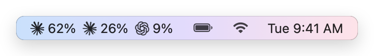
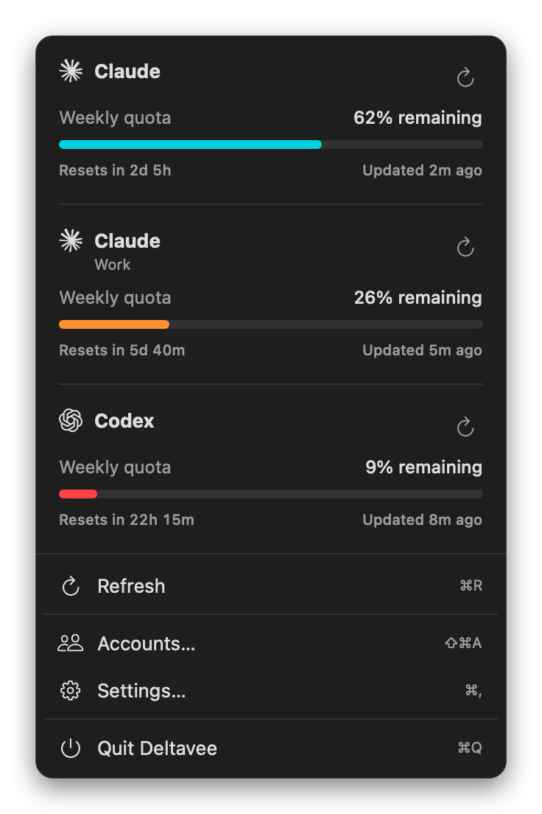

<p align="center">
  
</p>

<h1 align="center">Deltavee</h1>

<p align="center">Claude와 Codex의 주간 구독 사용량을 계정별로 macOS 메뉴바에 표시합니다.</p>

<p align="center">
  
  
  
  
</p>

<p align="center"><a href="README.md">English</a></p>

Deltavee(`/ˈdɛltəviː/`)라는 이름은 우주선이 궤도를 바꾸는 데 쓸 수 있는 속도 변화량 예산인 delta-v(Δv)에서 따왔습니다. 여기서는 agent가 쓸 수 있는 남은 사용량을 뜻합니다.

Deltavee는 같은 제공자의 계정 여러 개를 포함해 Claude·Codex 계정을 함께 표시합니다. 계정마다 Claude Code나 Codex CLI가 이미 유지하는 로그인 상태를 읽으므로 앱 자체 로그인은 없습니다.

<p align="center">
  
  <br>
  
</p>

<p align="center">
  
  
</p>

## 기능

- 메뉴바에 계정별 주간 사용량을 제공자 로고와 함께 표시합니다. 기본은 남은 비율이고, 사용한 비율로 바꿀 수 있습니다. 끝의 `!`는 마지막 조회 실패를 뜻합니다. 1시간 넘게 지난 값은 흐린 색으로 표시하며, `Color menu bar usage`를 켜면 빈 점으로 구분합니다.
- 패널에는 사용한 비율에 따라 색이 바뀌는 주간 사용량 막대와 한도 초기화 시각을 표시합니다.
- 계정마다 레이블을 붙이고, 드래그로 순서를 바꾸고, 메뉴바 표시 여부를 정할 수 있습니다.
- 전체 계정의 사용량을 주기적으로 조회하거나 계정 하나를 즉시 조회합니다. Claude OAuth 요청이 제한되면 대기한 뒤 다시 조회합니다.
- 토큰을 저장하지 않습니다. `Statusline Only` 모드에서는 Claude 사용량을 확인할 때 키체인을 읽거나 제공자에게 직접 요청하지 않습니다.
- 설정하면 로그인 시 실행합니다.
- 새 정식 버전이 있으면 패널에 알립니다. 다운로드 페이지를 열어 직접 설치하며, 앱이 자동으로 다운로드하거나 설치하지 않습니다.

## 수집 방식

- Codex: 계정별로 Codex CLI를 실행해 주간 사용량을 조회합니다. 앱은 `auth.json`을 읽거나 쓰지 않습니다. OpenAI는 로컬 또는 오픈소스 앱의 app-server 인증을 허용하지만, 상업·호스팅 서비스에는 허용하지 않습니다([Codex app-server](https://learn.chatgpt.com/docs/app-server#auth-endpoints)).
- Claude: CLI의 인증 정보로 비공식 API에 사용량을 요청하고, 조회에 실패하면 상태줄 기록을 읽습니다. 앱은 갱신 토큰을 사용하거나 인증 정보를 저장하지 않습니다. 액세스 토큰이 만료되면 Claude Code를 실행해 갱신을 시도하며, 실행마다 Haiku 모델 요청 1회분의 사용량을 소모합니다.
- 주간 사용량만 수집합니다. 5시간 한도 등 다른 한도는 표시하지 않습니다.
- 앱 데이터는 `~/Library/Application Support/dev.pers0n4.deltavee/`에 저장하며 토큰은 저장하지 않습니다.

조회·재시도 방식, 데이터 저장, 계정 위험은 [수집 동작](docs/collection.md), 표시 설정과 업데이트 알림은 [화면 안내](docs/interface.md)를 참고하세요.

> [!WARNING]
> 기본 Claude 모드는 Claude Code의 키체인 항목을 읽어 비공식 API를 호출합니다. Anthropic은 개발자가 Claude.ai 인증 정보나 세션 토큰을 수집·저장·중개하는 것을 허용하지 않습니다([Legal and compliance](https://code.claude.com/docs/en/legal-and-compliance)). 이 사용이 허용되는지는 확인되지 않았으며, 계정 정지 위험이 없다고 보장할 수 없습니다.
>
> `Settings… → Data collection → Claude → Statusline Only`는 더 보수적인 선택입니다. Claude Code 상태줄이 로컬에 기록한 값만 읽으며, 토큰을 읽거나 제공자에게 직접 요청하지 않습니다. CLI가 새 값을 기록해야 사용량이 갱신됩니다. 이 모드도 계정 위험이 없다고 보장할 수 없습니다.

## 시작하기

### 사전 준비

- macOS 26 이상
- Xcode 26 이상(소스 빌드용)
- Claude Code 또는 Codex CLI 설치
- [mise](https://mise.jdx.dev/)(선택, 빌드·설치 task 실행용)

### 설치

#### 다운로드

배포본은 [GitHub Releases](https://github.com/pers0n4/deltavee/releases)에서 확인합니다. GitHub의 소스 코드 압축 파일이 아니라 `Deltavee.app`이 포함된 ZIP 파일을 받습니다. Deltavee를 종료하고 ZIP을 푼 뒤 `Deltavee.app`을 `~/Applications`에 복사해 실행합니다.

#### Homebrew (Apple Silicon)

```bash
brew install --cask pers0n4/tap/deltavee
```

업데이트할 때는 Deltavee를 종료하고 `brew upgrade --cask pers0n4/tap/deltavee`를 실행한 뒤 앱을 다시 엽니다.

앱만 제거하거나 로컬 데이터까지 지우려면 [제거](#제거)를 참고하세요.

#### 소스에서 빌드

저장소를 복제하고 해당 디렉터리로 이동합니다.

```bash
git clone https://github.com/pers0n4/deltavee.git
cd deltavee
```

기존 설치를 업데이트한다면 먼저 Deltavee를 종료하세요. 저장소 루트에서 다음 명령으로 빌드하고 설치합니다. Apple Development 인증서는 필요하지 않습니다.

```bash
sh scripts/bundle.sh
sh scripts/install.sh
open ~/Applications/Deltavee.app
```

mise를 사용한다면 먼저 `mise.toml`을 확인하고 아래 명령으로 빌드·설치합니다. 파일에 지정된 도구가 추가로 설치될 수 있습니다.

```bash
mise trust mise.toml
mise run install
open ~/Applications/Deltavee.app
```

### 계정 추가

계정을 추가하기 전에 [수집 방식](#수집-방식)의 계정 위험 경고를 읽어 주세요.

1. 계정마다 별도의 CLI 설정 디렉터리를 사용합니다. 이미 로그인했다면 해당 디렉터리를 그대로 사용하세요. 새로 로그인해야 한다면 아래에서 제공자와 계정에 맞는 예시만 실행하세요.

   **Claude Code**

   ```bash
   claude                                          # 기본 계정(~/.claude): CLAUDE_CONFIG_DIR 없이 실행
   CLAUDE_CONFIG_DIR="$HOME/.claude-work" claude   # 추가 계정(예: 업무): 로그인 후 종료
   ```

   **Codex**

   ```bash
   codex login                                     # 기본 계정(~/.codex)
   CODEX_HOME="$HOME/.codex-personal" codex login  # 추가 계정(예: 개인)
   ```

   추가 계정은 CLI 환경 변수와 앱의 계정 설정에 같은 절대 경로를 지정합니다. 경로 끝에는 슬래시를 붙이지 않습니다.

2. 패널 하단의 `Accounts…`를 열고 `Add Account`에서 제공자를 고릅니다. 새 계정 카드에 설정 디렉터리를 입력합니다. 레이블은 생략할 수 있습니다. 기본 디렉터리는 `~/.claude`, `~/.codex`입니다.

`Settings… → Data collection → Codex → CLI path (optional)`를 비워 두면 Homebrew 경로와 `~/.local/bin/codex`, `PATH`에서 탐색합니다.

### 선택 설정

#### Claude 상태줄 훅 설정

이 훅은 Claude Code 상태줄의 주간 사용량을 기록합니다. `Statusline Only` 모드에서 사용하거나, OAuth 조회가 실패했을 때 대체값으로 사용합니다. Deltavee를 한 번 실행하면 앱 전용 폴더에 훅이 복사됩니다. 이후 앱을 열 때 훅을 갱신하되 Claude 설정은 변경하지 않습니다. 훅 실행에는 `/usr/bin/python3`가 필요합니다.

훅을 사용하려는 각 Claude 계정의 설정 디렉터리에서 `settings.json`에 다음 `statusLine` 항목을 추가합니다. 기본 계정은 `~/.claude/settings.json`을 수정합니다. 기존 파일 전체를 덮어쓰지 마세요.

```json
{
  "statusLine": {
    "type": "command",
    "command": "sh \"$HOME/Library/Application Support/dev.pers0n4.deltavee/bin/claude-statusline-capture.sh\""
  }
}
```

이미 상태줄 명령을 쓰고 있다면 `command` 문자열 안에서 `DELTAVEE_CHAIN_CMD`로 기존 명령을 지정합니다. 기존 명령은 같은 입력을 받고, 출력은 그대로 표시됩니다.

```json
{
  "statusLine": {
    "type": "command",
    "command": "DELTAVEE_CHAIN_CMD='~/.claude/statusline.sh' sh \"$HOME/Library/Application Support/dev.pers0n4.deltavee/bin/claude-statusline-capture.sh\""
  }
}
```

#### 로그인 시 자동 실행

Mac 로그인 시 Deltavee를 자동으로 실행하려면 `Settings…`에서 `Launch at login`을 켭니다.

## 제거

1. `Launch at login`이 켜져 있으면 `Settings…`에서 끈 뒤 Deltavee를 종료합니다.
2. 상태줄 훅을 활성화했다면 해당 계정의 `settings.json`에서 Deltavee의 `statusLine` 항목을 지우거나, `DELTAVEE_CHAIN_CMD`에 지정한 기존 명령으로 되돌립니다.
3. 설치 방식에 맞춰 앱을 제거합니다.
   - **Homebrew:** `brew uninstall --cask pers0n4/tap/deltavee`를 실행합니다. 계정 설정과 사용량 기록 등 앱 데이터도 지우려면 제거 명령에 `--zap`을 추가합니다.
   - **ZIP·소스 설치:** 설치한 위치에서 `Deltavee.app`을 지웁니다. 앱 데이터도 지우려면 `~/Library/Application Support/dev.pers0n4.deltavee`를 삭제합니다.

   소스에서 빌드했다면 `~/Library/Caches/deltavee`의 빌드 캐시도 별도로 삭제할 수 있습니다.

4. 토큰 자동 갱신을 사용했다면 각 Claude 계정의 설정 디렉터리에서 `projects/` 아래에 있는 `-deltavee-claude-refresh`로 끝나는 항목을 지웁니다.

앱은 키체인 항목을 만들지 않으므로 CLI 로그인에는 영향이 없습니다.

## 라이선스

[MIT](LICENSE) 라이선스입니다. 제3자 로고와 상표는 이 라이선스의 적용 대상이 아니며, [로고 출처와 상표권](docs/interface.md#logo-sources-and-trademarks)을 참고합니다.
