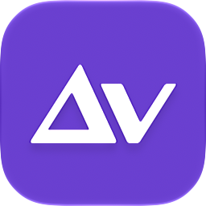
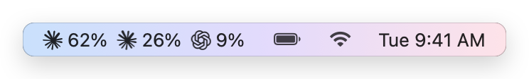
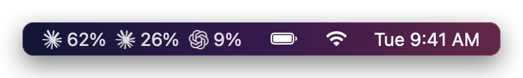
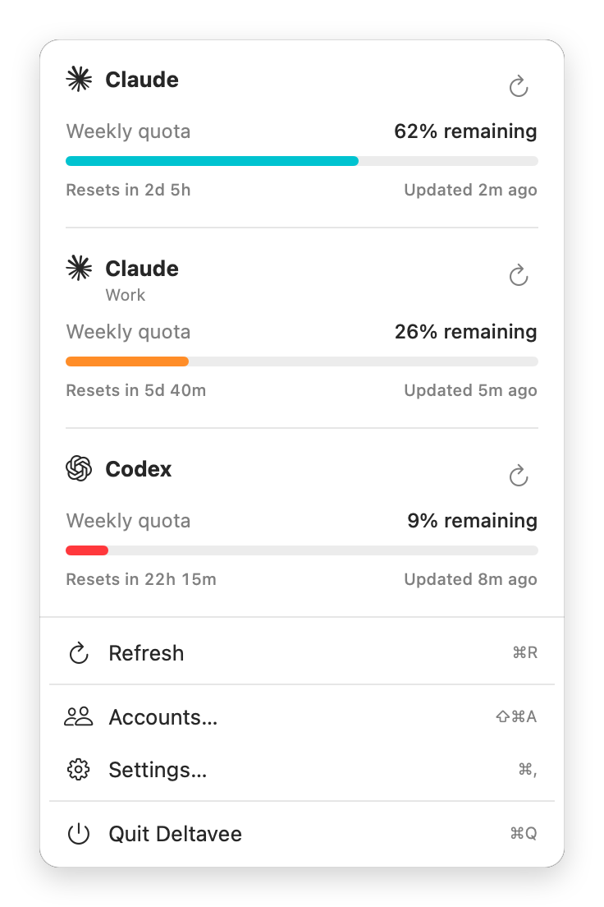
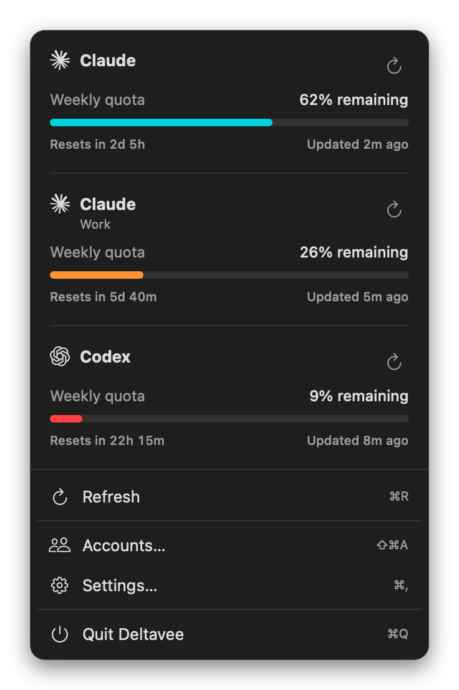

<p align="center">
  
</p>

<h1 align="center">Deltavee</h1>

<p align="center">Weekly Claude and Codex subscription usage, per account, in your macOS menu bar.</p>

<p align="center">
  
  
  
  
</p>

<p align="center"><a href="README.ko.md">한국어</a></p>

Deltavee (`/ˈdɛltəviː/`) is named after delta-v (Δv), the change in velocity a spacecraft has left to spend. Here, it is the quota your agents have left to spend.

It tracks several Claude and Codex accounts side by side, including more than one account of the same provider. For each account, it uses the CLI's existing login state, so the app has no sign-in of its own.

<p align="center">
  
  <br>
  
</p>

<p align="center">
  
  
</p>

## Features

- Shows each account's weekly quota next to its provider logo in the menu bar, as the remaining share by default or as the used share. A trailing `!` marks a failed last fetch. Values more than an hour old are dimmed, or shown with a hollow dot when `Color menu bar usage` is enabled.
- The panel shows a weekly quota bar, colored by how much of the quota is used, and the reset time.
- Accounts can be labeled, reordered by dragging, and hidden from the menu bar.
- Refreshes all accounts on a schedule or one account on demand, and waits out Claude rate limits instead of retrying.
- Stores no tokens. Claude's `Statusline Only` mode disables Keychain and network access for Claude usage collection.
- Launches at login if enabled.
- Shows an in-panel notice when a new stable version is available. Open its download page and install it manually; the app never downloads or installs updates.

## How It Collects Usage

- Codex: Runs the Codex CLI for each account to fetch weekly limits. The app does not read or write `auth.json`. OpenAI permits app-server authentication for local or open-source apps, but not for commercial or hosted services ([Codex app-server](https://learn.chatgpt.com/docs/app-server#auth-endpoints)).
- Claude: Fetches usage through an unofficial API with the CLI's credentials, falling back to statusline records on failure. The app does not use refresh tokens or store credentials. When the access token expires, it runs Claude Code to refresh it. Each run consumes usage for one Haiku model request.
- Collects weekly usage only. Five-hour and other limits are not shown.
- App data is stored in `~/Library/Application Support/dev.pers0n4.deltavee/`. Tokens are not stored.

See [collection details](docs/collection.md) for refresh behavior, data storage, and account risks, and [interface guidance](docs/interface.md) for display settings and update notices.

> [!WARNING]
> The default Claude mode reads the Claude Code Keychain item and calls an unofficial endpoint. Anthropic does not allow developers to collect, store, or act as an intermediary for Claude.ai credentials or session tokens ([Legal and compliance](https://code.claude.com/docs/en/legal-and-compliance)). Whether this use is allowed is unconfirmed, and there is no guarantee against account suspension.
>
> `Settings… → Data collection → Claude → Statusline Only` is more conservative: it reads only values the Claude Code statusline records locally, without reading tokens or calling the provider. Values update only when the CLI records new ones. This mode carries no guarantee against account risk either.

## Getting Started

### Prerequisites

- macOS 26 or later
- Xcode 26 or later, to build from source
- Claude Code or the Codex CLI installed
- [mise](https://mise.jdx.dev/) (optional, to run the build and install tasks)

### Install

#### Download

Check [GitHub Releases](https://github.com/pers0n4/deltavee/releases) for downloadable builds. Download the ZIP containing `Deltavee.app`, not GitHub's source-code archives. Quit Deltavee, extract the ZIP, copy `Deltavee.app` to `~/Applications`, and open it.

#### Homebrew (Apple silicon)

```bash
brew install --cask pers0n4/tap/deltavee
```

To update, quit Deltavee, run `brew upgrade --cask pers0n4/tap/deltavee`, and open it again.

#### Build from Source

Clone the repository and enter it:

```bash
git clone https://github.com/pers0n4/deltavee.git
cd deltavee
```

From the repository root, build and install with the commands below. No Apple Development certificate is required.

```bash
sh scripts/bundle.sh
sh scripts/install.sh
open ~/Applications/Deltavee.app
```

With mise, review `mise.toml` first, then run the commands below to build and install. Mise may also install the tools listed in that file.

```bash
mise trust mise.toml
mise run install
open ~/Applications/Deltavee.app
```

### Adding Accounts

Before adding accounts, read [How It Collects Usage](#how-it-collects-usage), including the account-risk warning.

1. Use a separate CLI config directory for each account. If you are already signed in, reuse that directory. For a new sign-in, run only the example that matches your provider and account.

   **Claude Code**

   ```bash
   claude                                          # default account (~/.claude): run without CLAUDE_CONFIG_DIR
   CLAUDE_CONFIG_DIR="$HOME/.claude-work" claude   # additional account, e.g. work: sign in, then exit
   ```

   **Codex**

   ```bash
   codex login                                     # default account (~/.codex)
   CODEX_HOME="$HOME/.codex-personal" codex login  # additional account, e.g. personal
   ```

   For additional accounts, use the same absolute path, without a trailing slash, in the CLI environment variable and the account settings in Deltavee.

2. Open `Accounts…` at the bottom of the panel and choose a provider from `Add Account`. Enter the config directory in the new account card; you can leave the label blank. The default directories are `~/.claude` and `~/.codex`.

If `Settings… → Data collection → Codex → CLI path (optional)` is left empty, the app searches Homebrew paths, `~/.local/bin/codex`, and `PATH`.

### Optional Settings

#### Configuring the Claude Statusline Hook

This optional hook records Claude Code statusline values for `Statusline Only` mode and as a fallback when OAuth fetches fail. Open Deltavee once to copy the hook to its local support folder. Deltavee keeps the copy up to date at launch without changing Claude's settings. The hook requires `/usr/bin/python3`.

To enable it, add the following to `<config directory>/settings.json` (`~/.claude/settings.json` for the default account).

```json
{
  "statusLine": {
    "type": "command",
    "command": "sh \"$HOME/Library/Application Support/dev.pers0n4.deltavee/bin/claude-statusline-capture.sh\""
  }
}
```

To keep an existing statusline command, set it in `DELTAVEE_CHAIN_CMD` inside the `command` string. That command receives the same input, and its output is displayed unchanged.

```json
{
  "statusLine": {
    "type": "command",
    "command": "DELTAVEE_CHAIN_CMD='~/.claude/statusline.sh' sh \"$HOME/Library/Application Support/dev.pers0n4.deltavee/bin/claude-statusline-capture.sh\""
  }
}
```

#### Launch at Login

To start Deltavee automatically when you log in to your Mac, turn on `Launch at login` in `Settings…`.

## Uninstall

1. If `Launch at login` is on, turn it off in `Settings…`, then quit Deltavee.
2. If you installed the statusline hook, remove `statusLine` from each `<config directory>/settings.json`, or restore the command set in `DELTAVEE_CHAIN_CMD`.
3. Delete the app, its data, and the build cache.

   ```bash
   rm -rf ~/Applications/Deltavee.app
   rm -rf ~/Library/Application\ Support/dev.pers0n4.deltavee
   rm -rf ~/Library/Caches/deltavee  # build output and bundle
   ```

4. For Claude accounts, delete the `projects/` entry ending in `-deltavee-claude-refresh` in each config directory. The token refresh creates it.

The app creates no Keychain items, so CLI sign-ins are unaffected.

## License

[MIT](LICENSE). Third-party logos and trademarks are not covered by this license; see [Logo sources and trademarks](docs/interface.md#logo-sources-and-trademarks).
